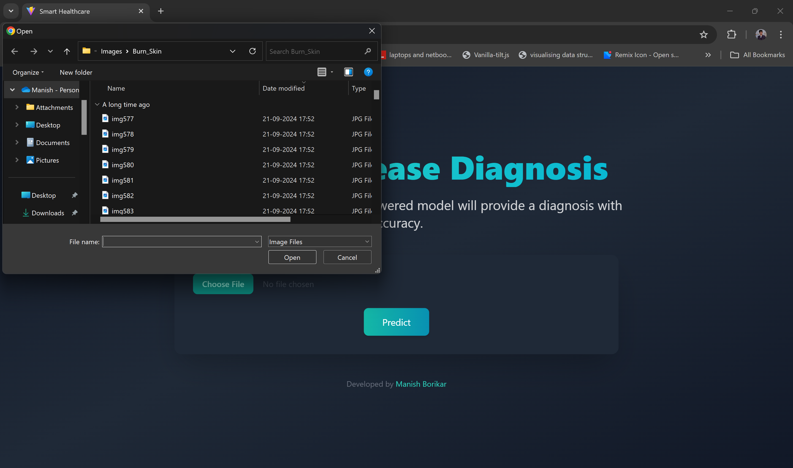
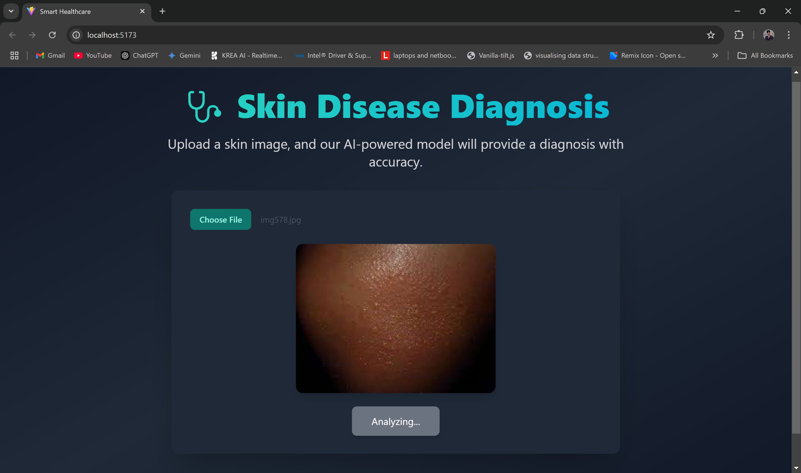
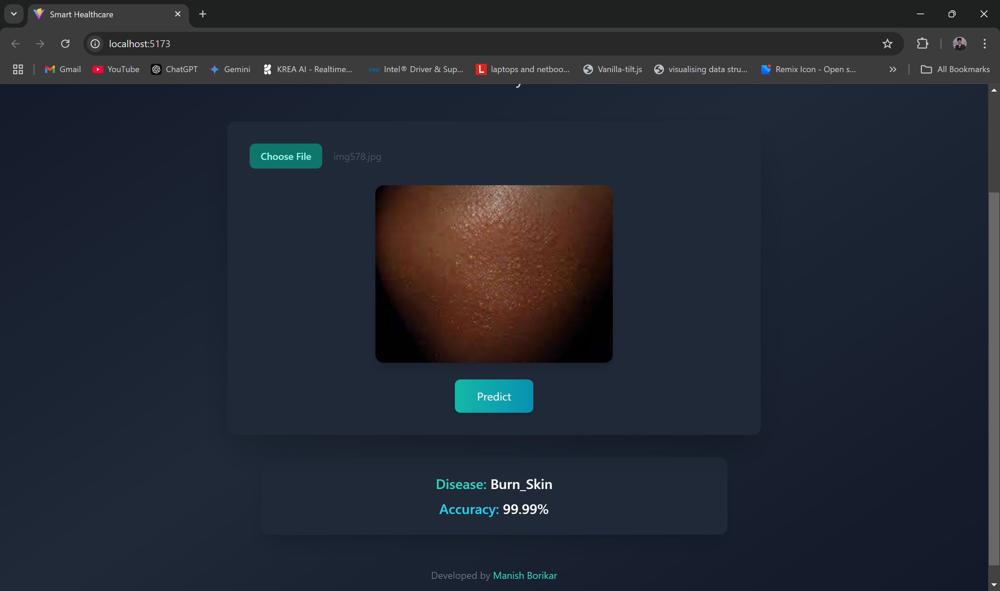

# 🩺 Smart Healthcare App

This **Smart Healthcare App** leverages a custom-trained **ResNet-50 v2** model hosted on **Hugging Face Spaces** to identify skin conditions from uploaded images. The app, rewritten with **Next.js 16** and **Tailwind CSS v4**, provides an intuitive and responsive interface for real-time edge predictions.

## 🌟 Features
- **AI-Powered Predictions**: Accurately classifies skin images into five categories:
  - Burn Skin
  - Healthy Skin
  - Malignant
  - Non-Cancerous
  - Non-Skin
- **Real-Time Analysis**: Get instant results with predicted disease and confidence scores directly in the browser via WebSockets.
- **Modern Design**: Built using Server and Client React components with a responsive, user-friendly Dark UI/UX.
- **Hugging Face Model API**: Leverages your custom-trained model deployed on Hugging Face for seamless predictions.

## 🚀 Live Demo
Explore the app on different platforms (original deploys):

- **On Vercel**: [Smart Healthcare App](https://smart-healthcare-ai.vercel.app/)
- **On Streamlit**: [Smart Healthcare App](https://smart-healthcare.streamlit.app/)
- **On Render**: [Smart Healthcare App](https://smart-healthcare-xe3p.onrender.com/)

---

## 🖼️ How It Works (Visual Guide)

### 1. Upload an Image  
Users can upload a skin lesion image directly through the drag-and-drop file uploader.  


### 2. AI Prediction  
Once the image is uploaded, it is streamed to the Hugging Face API for processing via `@gradio/client`.  


### 3. Results Displayed  
The app parses the AI outcome and displays the classified disease along with its confidence accuracy score.  


---

## 🛠️ Technologies Used
- **React 19 & Next.js 16 (App Router)**: High-performance, SEO-friendly framework.
- **Tailwind CSS v4**: Utility-first CSS using JS-free `@theme` styling.
- **Hugging Face Spaces**: For hosting and executing the model inference API endpoint.
- **TensorFlow / Python**: For offline training the core skin condition model (`model/` folder).

---

## 📋 Installation (For Local Development)

1. **Clone the Repository**:
   ```bash
   git clone https://github.com/manishborikar92/Smart-Healthcare-React.git
   cd Smart-Healthcare-React
   ```

2. **Navigate to the web workspace & Install Dependencies**:
   ```bash
   cd web
   npm install
   ```

3. **Start the Development Server**:
   ```bash
   npm run dev
   ```

4. **Open the App**:  
   Navigate to `http://localhost:3000` in your browser.

---

## 📂 Project Structure

This is a polyglot monorepo partitioned into two core domains:

```
.
├── docs/                  # In-depth architectural, setup, and SEO documentation
├── images/                # Screenshots for documentation
├── model/                 # Python scripts, dependencies, testing utilities for Machine Learning
├── web/                   # The primary Next.js Frontend Workspace
│   ├── src/app/           # Next.js Routing
│   ├── src/components/    # Server and Client UI Components
│   └── package.json       # Node.js dependencies
├── README.md              # Global project documentation
└── package.json           # Monorepo coordinator
```

---

## ⚠️ Disclaimer
This app is intended for **educational purposes only**. It should not be used as a substitute for professional medical advice. Always consult a certified healthcare provider for diagnosis and treatment.

---

## 👨🏻‍💻 Developers

### Manish Borikar  
- **Email**: [manishborikar@proton.me](mailto:manishborikar@proton.me)  
- **GitHub**: [manishborikar92](https://github.com/manishborikar92)

### Prankita Potbhare  
- **Email**: [prankitapotbhare@proton.me](mailto:prankitapotbhare@proton.me)  
- **GitHub**: [prankitapotbhare](https://github.com/prankitapotbhare)  

---

## 🏅 Acknowledgments
- **Hugging Face Spaces** for model hosting and API support.
- **Next.js & Vercel** for providing a robust frontend Edge framework.
- **TensorFlow & Python** for enabling advanced AI model training.