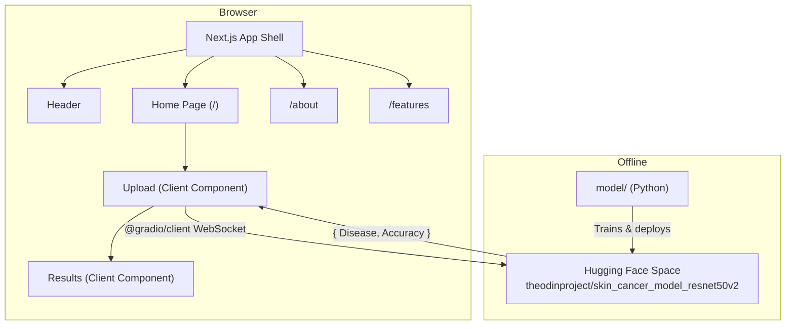

# Architecture

## System Overview

Smart Healthcare AI is a stateless, client-rendered web application with no backend. The Next.js 16 App Router serves pre-rendered HTML shells for three routes. The core interactivity — image upload and AI classification — happens entirely in the browser. The user's browser connects directly to a Hugging Face Space via the `@gradio/client` WebSocket library to perform inference against a ResNet-50 v2 model. No data is persisted; no server-side state exists.

## Architectural Pattern

The application follows a **client-side integration pattern with a static shell**. Next.js provides file-system routing, SEO metadata, and server-side rendering for static pages (`/about`, `/features`). The home page (`/`) renders a server-side shell but delegates all interactivity to a client component (`Upload.jsx`) that manages the full prediction lifecycle. There is no API layer, no database, and no server-side business logic.

The `model/` directory is architecturally independent — it contains offline Python scripts for training the ML model and is never invoked by the web application.

## Component Diagram

## Components

### Next.js App Shell

**Location:** `web/src/app/layout.js`
**Responsibility:** Root layout that wraps all pages with the HTML document, Inter font, global CSS, background decorations, smooth scrolling, skip navigation, Header, and Footer.

The layout uses the Next.js Metadata API to define global SEO metadata including Open Graph, Twitter Card, and title templates. Every child route inherits this layout.

### Home Page

**Location:** `web/src/app/page.js`
**Responsibility:** Landing page with hero section, feature highlight pills, and the Upload component.

This is the primary entry point for users. The page shell is server-rendered (hero text, highlight pills), but the Upload component is a client component that handles all browser interaction.

### About Page

**Location:** `web/src/app/about/page.js`
**Responsibility:** Static information page describing the project mission, technology, team, and how the application works.

Fully server-rendered with no client-side interactivity. Exported metadata for SEO.

### Features Page

**Location:** `web/src/app/features/page.js`
**Responsibility:** Static feature showcase rendered as a grid of `FeatureCard` components.

Fully server-rendered. Lists eight features with icons, descriptions, and bullet points.

### Upload Component

**Location:** `web/src/components/features/Upload.jsx`
**Responsibility:** Core interactive component that handles the complete prediction lifecycle: Gradio client connection, drag-and-drop file upload, image preview, prediction request, error handling, and result delegation.

This is a client component (`'use client'`). On mount, it establishes a WebSocket connection to the Hugging Face Space using `Client.connect()`. When the user uploads an image and clicks "Analyze Image", it calls `model.predict('/predict', { image: selectedFile })` and renders the result via the `Results` component.

### Results Component

**Location:** `web/src/components/features/Results.jsx`
**Responsibility:** Displays classification results with severity-aware colour coding, confidence bar, and conditional medical disclaimer.

Maps the five disease categories (`Burn_Skin`, `Healthy_Skin`, `Malignant`, `Non_Cancerous`, `Non_Skin`) to visual configurations (colour, icon, severity level). Shows a medical disclaimer for `danger` and `warning` severity results.

### FeatureCard Component

**Location:** `web/src/components/features/FeatureCard.jsx`
**Responsibility:** Reusable presentation card displaying a feature with icon, title, description, and bullet list. Used on the Features page.

Server component — no client-side directives.

### Header Component

**Location:** `web/src/components/layout/Header.jsx`
**Responsibility:** Sticky navigation bar with logo, desktop nav links, mobile hamburger drawer, and scroll-aware visual state.

Client component (`'use client'`). Uses `usePathname()` for active link detection, `useState` for mobile menu toggle and scroll state, and `framer-motion` for animated active indicator.

### Footer Component

**Location:** `web/src/components/layout/Footer.jsx`
**Responsibility:** Three-column footer with platform info, model architecture details, developer credits, tech badges, and medical disclaimer.

Server component — uses `next/image` for SVG assets but requires no client-side hooks.

### SmoothScroll Component

**Location:** `web/src/components/layout/SmoothScroll.jsx`
**Responsibility:** Wraps the application in `ReactLenis` for smooth scroll interpolation.

Client component (`'use client'`). Configures Lenis with `lerp: 0.08`, `duration: 1.2`, `smoothTouch: false`, and `syncTouch: true`.

## Data Flow

### Image Classification Flow

1. **Page load** — The `Upload` component mounts and calls `Client.connect('theodinproject/skin_cancer_model_resnet50v2')` to establish a WebSocket connection to the Hugging Face Space. A loading indicator shows while connecting.
2. **File selection** — The user selects an image via drag-and-drop or the file picker. The file is validated as an image type. A preview is created using `URL.createObjectURL()`.
3. **Prediction request** — The user clicks "Analyze Image". The component calls `model.predict('/predict', { image: selectedFile })`, sending the raw `File` object to the Gradio API.
4. **Response handling** — The Hugging Face Space returns `{ Disease: string, Accuracy: string }`. The `Upload` component stores this in state and passes it to the `Results` component.
5. **Result rendering** — The `Results` component maps the disease name to a visual configuration (colour, severity, icon, description) and renders the classification card with a confidence bar. For `danger` or `warning` severity, a medical disclaimer is displayed.

## External Dependencies

| Service                  | Purpose                                      | Required | Notes                                |
|--------------------------|----------------------------------------------|----------|--------------------------------------|
| Hugging Face Spaces      | Hosts the ResNet-50 v2 model for inference   | Yes      | Public endpoint, no API key needed   |
| Vercel                   | Production deployment and CDN                | No       | Used for production hosting           |
| Google Fonts (Inter)     | Typography loaded via `next/font/google`     | No       | Font is self-hosted after build      |

## Key Design Decisions

- **No backend** — The application was designed without a server-side API layer. All inference is performed client-side via the Gradio WebSocket client. This eliminates server costs and complexity but means all processing depends on the Hugging Face Space availability. See [MIGRATION-RECORD.md](./MIGRATION-RECORD.md) for the decision context.

- **Client-side Gradio connection** — The `@gradio/client` library runs in the browser rather than in a Next.js API route. This was chosen because the Gradio client uses WebSockets and browser APIs that are incompatible with server-side execution in the current architecture.

- **Polyglot monorepo** — Python ML code and JavaScript web code coexist in the same repository but are architecturally independent. Next.js cannot execute Python, so the `model/` directory serves only as offline developer tooling.

- **Dark-only theme** — A single dark theme was chosen to provide appropriate contrast for medical imaging and to align with the medical-tech brand identity.

## Known Limitations

- The Hugging Face Space URL is hardcoded in `Upload.jsx`. If the Space moves or becomes unavailable, the application cannot perform predictions.
- No image size or dimension validation is performed before sending to the model. Very large images may cause slow uploads.
- The application has no test suite. There are no unit, integration, or end-to-end tests.
- No CI/CD pipeline is configured. Deployment relies on Vercel's Git integration.
- The model classifies into exactly five categories. Any condition outside these categories will receive a best-effort classification.
